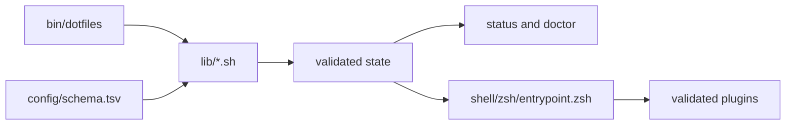

# Runtime architecture

`bin/dotfiles` is the management entrypoint. It resolves the repository root,
loads the portable Bash libraries in a fixed order, and dispatches each public
subcommand through `dotfiles_main`.

The interactive boundary is `shell/zsh/entrypoint.zsh`. It imports resolved
configuration and plugin state into Zsh without making the management CLI a
second runtime owner.

## Command flow

The split keeps configuration parsing and validation in shared libraries while
leaving interactive shell behavior at the Zsh boundary.

## Evidence

- `bin/dotfiles:8-29` fixes library load order; `bin/dotfiles:50-95` owns public
  command dispatch.
- `shell/zsh/entrypoint.zsh` consumes validated runtime state before sourcing
  plugins.
- `lib/status.sh` exposes effective state through `status` and `doctor`.

See the broader [architecture guide](../architecture.md).
